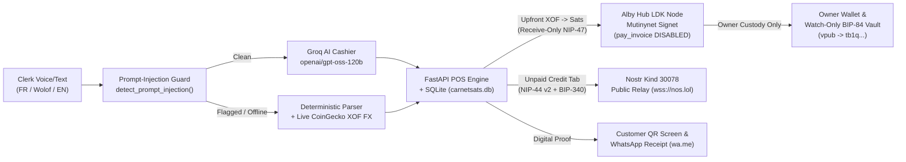

# ⚡ CarnetSats — Voice/Text Boutique POS on Lightning + Nostr

[](https://github.com/alexowoade/carnetsats/actions/workflows/test.yml)


> **Dakar Bitcoin Hack by BTrust 2026** — A trilingual (**French / Wolof / English**) voice-and-text point-of-sale for West African neighborhood shops (*boutiques de quartier*). A clerk speaks or types a sale, the AI cashier parses it, a **receive-only Lightning invoice (NIP-47 NWC)** is issued for the upfront amount, and the unpaid balance is recorded on a **NIP-44 v2 encrypted Nostr credit tab (`Kind 30078`)**. Surplus hot-wallet funds are flagged for cold-storage sweep by a watch-only **BIP-84** policy—so shopkeepers digitize paper credit notebooks (*carnets de dettes*) without exposing spending keys at the counter.

🔗 **Live Hosted MVP (AWS EC2 + Caddy HTTPS):** https://carnetsats.duckdns.org  
🛡️ **STRIDE Threat Model:** [SECURITY.md](SECURITY.md)

---

## Live Verification Proof (Mutinynet + Public Nostr Relay)

- **Real Lightning Settlement Verified (2026-11-19):** Live Mutinynet Alby Hub issued a `lntbs...` BOLT11 invoice via receive-only NIP-47 NWC (`#e`-tag matched in `v3.8.1`); the Mutinynet faucet paid **263 sats** and CarnetSats verified `SHA256(preimage) == payment_hash`.
- **Real Public Nostr Ledger:** Every checkout and tab repayment publishes a BIP-340 Schnorr-signed, NIP-44 v2 encrypted `Kind 30078` event to `wss://nos.lol` (inspectable via `GET /api/nostr-events`).
- **Zero-Trust Counter Hardware:** The live NWC grant is strictly **receive-only** (`get_info`, `get_balance`, `make_invoice`, `lookup_invoice`, `list_transactions`). `pay_invoice` is excluded in Alby Hub *and* blocked in code (`RESTRICTED`). **Only the shop owner moves funds inside Alby Hub—never from the counter app.**
- **Automated Verification:** **235 deterministic offline tests** + **2 gated live tests** (`235 passed, 2 skipped` offline; `236 passed, 1 skipped` on EC2 with `CARNETSATS_NWC_URL` set).

---

## Test It Live in 30 Seconds (Judge Playbook)

1. **Try Trilingual Split Checkout:** Open https://carnetsats.duckdns.org, toggle **`🇬🇧 EN` / `🇫🇷 FR` / `🇸🇳 WO`**, and click **`🎙️ Wolof (Aminata)`** (`Aminata jël na ceeb ak diwlin ci 12 000 FCFA, fay na 7 000 FCFA, desal 5 000 FCFA`).
2. **Trigger a Real Mutinynet Lightning Payment (No Wallet Needed):**
   - Click **`📋 Copy Invoice`** (or open **`⛶ Show Customer`** to inspect the privacy-preserving customer QR screen).
   - Paste the `lntbs...` invoice into https://faucet.mutinynet.com (*Pay a Lightning Invoice*).
   - Watch CarnetSats auto-poll `/api/settle` (or click **`✅ Check Payment`**) to verify the real SHA-256 preimage and update the balance. *(Unpaid invoices stay `PENDING`—live mode never fakes payment.)*
3. **Audit Nostr Encryption & NIP-78 Repayment:** In Panel 2, click **`🔎 Schnorr/NIP-44`** to verify the BIP-340 signature and decrypt the `NIP-44 v2` ciphertext on the server, click **`🔍 Relay Payload`** to inspect `published_to`, then click **`💳 Repay`** to publish a replacement `Kind 30078` event (`debt_remaining_xof: 0`).
4. **Red-Team the Counter Firewall:** In Panel 4, click **`🛡️ pay_invoice Attack → RESTRICTED`** to see the NIP-47 block plus Zero-PII log redaction (`+221` phone numbers and NWC URLs stripped), then click **`🏦 Sweep to BIP-84 Vault`** to inspect the watch-only `tb1q...` cold-storage policy recommendation.

---

## Architecture — One-Way Deposit & Encrypted Ledger



> **Why Receive-Only?** The counter app collects payments and tracks encrypted tabs, while **only the owner moves money inside Alby Hub**—keeping spending keys and sweep execution completely off the counter device. That is why the cold sweep is policy-only and tab repayment is ledger-only: the till is a one-way deposit chute, not a wallet.

---

## Usefulness, Social Impact & Pilot Plan

### The Dakar Counter Problem

Neighborhood shopkeepers (*boutiques de quartier*) serve regular households through split payments: a customer pays part of a rice-and-oil basket upfront and puts the remainder in a paper credit notebook (*carnet de dettes*). Paper notebooks suffer from lost pages, calculation errors, and disputes—while handing a standard Bitcoin wallet to a counter clerk creates constant fear of wallet draining from hackers, prompt injections, or stolen counter phones.

### How CarnetSats Fits the Workflow

* **Respects informal credit:** Digitizes both halves of a split sale in one voice/text step instead of demanding 100% upfront payment.
* **Safe staff delegation (No wallet-draining fear):** Receive-only NWC + watch-only BIP-84 `vpub` turns the counter device into a one-way deposit terminal; incoming sats settle safely in the owner's Alby Hub.
* **Dignity & privacy on public rails:** Salted `client_<10-hex>` aliases + spec-compliant **NIP-44 v2** encryption + `+221`/`+234` PII log scrubbing ensure customer names and debt balances never leak onto public Nostr relays or server logs.
* **Built for real market conditions:** Lightweight single-file vanilla HTML/JS, high-contrast **Daylight** mode for outdoor stalls, deterministic offline parser/FX fallbacks, SQLite restart persistence, and **WhatsApp (`wa.me`) receipts** requiring zero customer app installs.

### 30-Day Dakar Pilot Metrics

1. **Checkout speed:** Median seconds from voice/text entry to settled invoice vs. paper notebook entry.
2. **Dispute rate:** Contested credit tabs per week before vs. after issuing WhatsApp hash receipts.
3. **Credit recovery:** Percentage of open tabs settled within 14 days via NIP-78 repayment updates.
4. **Offline resilience:** Percentage of sales completed seamlessly during connectivity drops via deterministic fallback + SQLite.
5. **Security integrity:** Zero unauthorized outbound spends from delegated counter sessions.

### Next Iteration Roadmap

* **Hardware-signer PSBT execution:** Wire a BDK PSBT builder so owners sign recommended BIP-84 cold sweeps offline (Coldcard / SeedSigner).
* **Authenticated multi-clerk sessions:** Replace request-level role fields with signed NIP-47/Nostr session auth and scoped CORS.
* **Dedicated Wolof ASR & WhatsApp reminders:** Integrate market-noise-tolerant Wolof speech-to-text and polite 1-click repayment reminders with fresh BOLT11 links.

---

## Security by Design & Honest Boundaries

Full STRIDE analysis across NWC, Nostr, and BIP-84 lives in [SECURITY.md](SECURITY.md).

| Primitive | Live EC2 Mode (`CARNETSATS_NWC_URL` Set) | Offline / Zero-Config Demo Mode |
| --- | --- | --- |
| **Lightning (BOLT11 / NIP-47)** | Real Mutinynet `lntbs...` invoices from Alby Hub over NIP-47 (`#e`-tag matched). Unpaid invoices stay `PENDING`; unreachable wallet returns error (no silent fallback). | Spec-correct `bolt11` Signet invoice signed with deterministic demo key (`sha256` seed); local SHA-256 preimage verification. |
| **Nostr Ledger (`Kind 30078`)** | Signed with fresh `CARNETSATS_MERCHANT_KEY` (`.env`), real **NIP-44 v2** (`secp256k1` ECDH + `HKDF-SHA256` + padding + `ChaCha20` + `HMAC-SHA256`), published async to `wss://nos.lol`. | Same real NIP-44 v2 & BIP-340 Schnorr signing (verified against `paulmillr/nip44` vectors); falls back to fixed demo key if `.env` absent. |
| **AI Cashier & Prompt Guard** | `detect_prompt_injection()` strips adversarial directives before calling Groq (`openai/gpt-oss-120b`); falls back deterministically on any error. | Deterministic FR/Wolof/EN parser (zero API key required). |
| **BIP-84 Cold Vault** | Real BIP-32/BIP-84 watch-only derivation (`m/84'/1'/0'/0/i` → `tb1q...`) via `bip-utils` from `CARNETSATS_VPUB` (or demo `vpub`). **Policy viewer only**—recommends sweep above 50,000 FCFA, moves no funds. | Same real `bip-utils` derivation; policy viewer only. |
| **Tab Repayment (`/api/repay-tab`)** | **Ledger-only** NIP-78 replacement event (`debt_remaining_xof: 0`, same `d` tag); no Lightning payment minted for bookkeeping. | Issues & settles a local demo invoice, then publishes NIP-78 replacement event. |

---

## Automated Verification Suite (235 Offline + 2 Live Tests)

Running `pytest` offline executes **235 passed, 2 skipped** (live relay and live NWC tests gated). On EC2 with `CARNETSATS_NWC_URL` configured, the suite runs **236 passed, 1 skipped**.

| Test Group | Count | What It Verifies |
| --- | --- | --- |
| **NIP-44 v2 Spec Vectors (`test_00`, `test_15a–g`)** | 109 | Official `paulmillr/nip44` vectors: 24 padding lengths, 35 conversation keys, 32 message keys, 10 encrypt/decrypt (including UTF-8 `🍕`), 3 long messages, 3 65 KB extended-prefix boundaries, empty-plaintext rejection, plus base spec vector. |
| **Security, PII, NIP-47 RBAC & Prompt Guard (`test_01`, `test_06–10`, `test_19a–c`)** | 45 | 12 `+221`/`+234`/NWC/`nsec` redactions, 12 NIP-47 RBAC cases, 5 invalid-amount guards, replay + quota guards, 6 NIP-44 tamper checks, 8 Groq prompt-injection tests. |
| **BIP-84 Vault & Sweep Policy (`test_03–05`)** | 18 | 10 `vpub` child derivations, 2 address determinism/uniqueness checks, 6 sweep-threshold boundaries (`50,000 FCFA`). |
| **Live NWC, Relay, SQLite, FX, Repay & UI (`test_17–18`, `test_20–22`)** | 28 | 5 FX cache/fallback checks, 3 SQLite restart persistence checks, 3 NIP-78 repayment tests, 1 frontend wiring check, 16 rev4 live-NWC/relay/secret tests. |
| **Trilingual AI, Groq, BOLT11, Aliases, E2E & Fuzz (`test_02`, `test_11–14`, `test_16`, `test_groq_*`)** | 35 | 8 alias invariants, 2 Schnorr/NIP-44 round-trips, 2 `bolt11` decode/preimage checks, 12 FR/Wolof/EN transcripts, 5 FastAPI E2E checks, 4 Hypothesis fuzz tests, 2 Groq live/fallback tests. |
| **Gated Live Tests (`test_15_nostr_relay_roundtrip.py`, `test_23_nwc_live.py`)** | 2 | Live public Nostr relay round-trip (`SKIP_RELAY_TESTS=0`) and live Mutinynet NWC round-trip (`CARNETSATS_NWC_URL`). |

---

## Quickstart (Local or Docker)

```bash
# 1-command setup: creates .venv (Python 3.12), generates fresh .env merchant key,
# runs the 235 deterministic tests, and serves the live MVP at http://localhost:8000
./run.sh

```

Or with Docker:

```bash
cp .env.example .env   # optional: add GROQ_API_KEY, CARNETSATS_NWC_URL, CARNETSATS_VPUB
docker compose up --build

```

*(Requires Python 3.12; `coincurve` does not build on Python 3.13.)*

---

## REST API Reference

| Endpoint | Method | Purpose |
| --- | --- | --- |
| `/api/state` | `GET` | Hot balance, `nwc_mode`, `merchant_key_source`, NIP-47 info, sweep policy, Nostr pubkey |
| `/api/checkout` | `POST` | Parse FR/WO/EN sale (Groq/deterministic), issue BOLT11 via NWC, publish NIP-44 `Kind 30078` |
| `/api/settle` | `POST` | Verify payment via NWC `lookup_invoice` (live) or SHA-256 preimage (demo) |
| `/api/repay-tab` | `POST` | Publish NIP-78 replacement `Kind 30078` event (`debt_remaining_xof: 0`, same `d` tag) |
| `/api/nostr-events` | `GET` | List stored Nostr credit events with `published_to` relay status |
| `/api/publish-nostr-event/{id}` | `POST` | Manually (re)publish a credit event to the configured relay |
| `/api/verify-nostr-event/{id}` | `GET` | Verify BIP-340 Schnorr signature via `pynostr` |
| `/api/decrypt-nostr-event/{id}` | `POST` | Decrypt NIP-44 v2 ciphertext server-side |
| `/api/security-test` | `POST` | Red-team check: blocked `pay_invoice` (`RESTRICTED`) + Zero-PII sanitized logs |
| `/api/sweep-policy` | `GET` | Watch-only BIP-84 cold-sweep recommendation (policy viewer only) |

---

## Project Files

* `carnetsats_engine.py` — NIP-47 engine, BIP-84 watch-only vault, NIP-44 v2 from spec, Schnorr ledger, SQLite persistence, Groq + deterministic parser, prompt-injection guard, PII sanitizer
* `nwc_client.py` — Subprocess-isolated live NIP-47 NWC client with `#e`-tag reply matching
* `app.py` — FastAPI REST server & web UI host
* `docs/index.html` — Single-file trilingual POS UI (Daylight mode, Customer QR modal, WebLN, WhatsApp receipts)
* `test_carnetsats.py` — 235 deterministic unit, fuzz, and E2E tests
* `test_15_nostr_relay_roundtrip.py` & `test_23_nwc_live.py` — Gated live relay and live NWC round-trip tests
* `SECURITY.md` — STRIDE threat model & honest boundary disclosures
* `run.sh`, `Dockerfile`, `docker-compose.yml`, `.env.example`, `requirements.txt`, `runtime.txt`, `.python-version`, `.github/workflows/test.yml`
